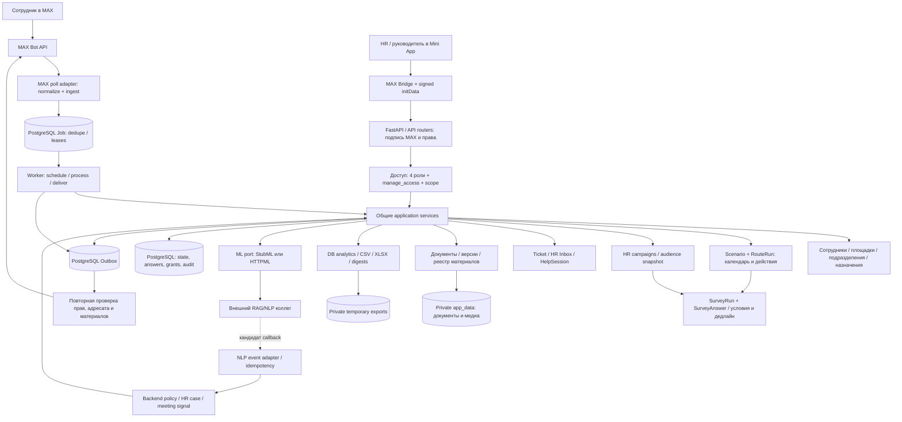
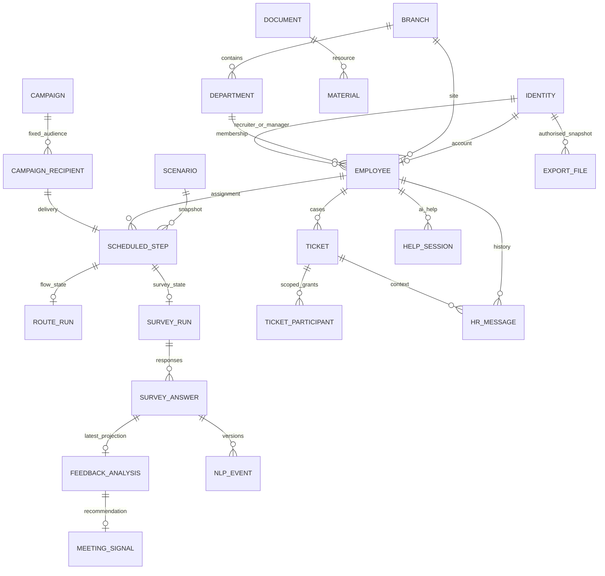

# Корсик: техническая архитектура

Модульное приложение Python 3.12 / FastAPI / SQLAlchemy 2 / PostgreSQL 17. Alembic 0005. Процессы API, worker и poll используют одни use cases и БД; их можно запускать в отдельных контейнерах. Локально допускается SQLite для тестов. PostgreSQL — рабочий вариант для нескольких процессов.



```mermaid
sequenceDiagram
  participant E as Сотрудник / MAX
  participant B as Backend + worker
  participant D as PostgreSQL
  participant ML as Внешний ML
  participant H as HR Mini App
  E->>B: incoming event_id / callback
  B->>D: Job unique(event_id)
  B->>D: lock Employee + сохранить состояние
  alt Ответ на опрос
    B->>D: SurveyAnswer / comment / position
    B->>D: Outbox следующего вопроса
  else /ask
    B->>D: HelpSession + точка возврата
    B->>ML: вопрос + история + разрешённые документы
    ML-->>B: answered / clarification / not_found
    B->>B: проверить источники и права
    alt Нет подтверждённого ответа
      B->>D: Ticket + HRMessage + уведомление HR
    else Ответ есть
      B->>D: Outbox «Удалось решить вопрос?»
    end
  else /hr текст
    B->>D: выбранный Ticket / сообщение, опрос не блокируется
  end
  H->>B: решение конкретного Ticket + Idempotency-Key
  B->>D: awaiting_confirmation / resolution_revision
  B-->>E: Ваш вопрос + Ответ HR + Да/Нет
  E->>B: подтверждение Ticket + актуальная ревизия
  B->>D: Да → closed; Нет → тот же Ticket в работе
```



## Границы ответственности

- `access`, `employees`, `admin_service`: авторизация, область данных, назначения, приглашения и конфигурация без изменения Python-кода.
- `calendar`, `scenarios`, `routes`, `surveys`, `campaigns`: расписание, упорядоченные действия, снимки версий, условия, паузы, ответы, дедлайны и очередь сценариев.
- `support`, `tickets`, `inbox`, `helpflow`: обращения с ID, получатели, цитирование вопроса, ревизии решения и подтверждение сотрудником; состояние ИИ-помощи отдельно от опроса.
- `documents`, `profile_v04`, `Material`: оригиналы, публикация и индексация, реестр обязательных вложений; исходные строки привязаны через source_ref.
- `reporting`, `analytics`, `digests`, `feedback`, `meetings`: числа из БД, срезы, выгрузки, политика HR и приватные рекомендации встречи.
- `ml.py`, `nlp_api`: граница с внешним сервисом, а не реализация моделей. MAX-адаптер — `max_client`, `commands`, `bot`.

## Надёжность и ограничения

Состояние бизнес-операции и Outbox сохраняются одной транзакцией. Job/Outbox имеют уникальные ключи; несколько worker используют leases и PostgreSQL `FOR UPDATE SKIP LOCKED`. MAX является внешней системой: универсальной exactly-once доставки нет. При неизвестном результате отправки сохраняется `uncertain`; автоматический повтор может дублировать сообщение, поэтому требует отдельного решения. Перед доставкой заново проверяются доступ, назначенный получатель и обязательные файлы.

API не доверяет скрытию кнопок: проверяются роль, область площадок и конкретные данные. Руководитель не получает исходные ответы и NLP-объяснения. Download-ссылки подписаны и ограничены по времени, права проверяются повторно. В технических логах — route template, status, request ID, тип ошибки и внутренние ID; токены, query strings и пользовательские тексты не логируются.

Для роста: отделять worker по видам заданий; переносить приватные файлы в объектное хранилище через отдельный порт; добавлять индексы по реальным нагрузочным замерам; выносить отчёты в фоновые задания при больших выборках. Доменная логика и модель доступа при этом сохраняются. Redis/Celery и микросервисы сейчас не являются зависимостями проекта.
