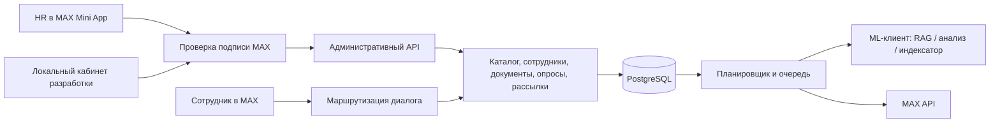

# Архитектура HR-кабинета и MAX Mini App

## Решения

HR и руководитель HR — бизнес-администраторы в пределах назначенной области. Главному HR доступна область «Все площадки» (`*`). HR создаёт служебные аккаунты, назначает рабочие роли и блокирует пользователей своей области; расширить её за пределы своей или выдать доверенное право `manage_access` он не может. Это право выдаётся отдельно и позволяет управлять доступом без рабочей роли HR. Руководители подразделений видят только своих сотрудников и агрегированный прогресс; сотрудники — только свои данные. Назначенный рекрутер определяет маршрут обращения, а не ограничивает доступ остальных HR-администраторов той же области.

## Границы модулей

- `dependencies.py`: общая транзакция запроса, аутентификация и административный доступ.
- `webapp.py`: HMAC-подпись MAX, срок запуска, привязанный аккаунт и короткая сессия.
- `admin_api.py`: HTTP-контракт кабинета, без SQL в браузере.
- `admin_service.py`: административные операции и проверка области/версии записи.
- `campaigns.py`: аудитория, неизменяемая публикация, очередь, отмена и результаты.
- Существующие `employees`, `scenarios`, `surveys`, `tickets`, `documents`, `analytics` сохраняют бизнес-ответственность. Бот и кабинет используют общие правила.
- `web/`: адаптивный интерфейс из отдельных HTML/CSS/JS-модулей; обслуживается тем же FastAPI.

## Новые сущности

`Department` — управляемое подразделение площадки. `SurveyTemplate` — редактируемый опросник с ревизией. `Campaign` — черновик сообщения/опроса, расписание, аудитория и снимок вопросов. `CampaignRecipient` — фиксированный получатель и связанный шаг. `WebSession` — хеш короткого токена с серверным сроком, привязанный к Identity.

Онбординг привязан к дате выхода. Независимая рассылка HR привязана к своей дате и не пересчитывается при переносе выхода сотрудника. Для действующего опроса сохраняется снимок вопросов. Шаблон можно исправлять без изменения уже полученных ответов.

## CRUD и история

Удаление сотрудников, площадок, подразделений, документов и шаблонов — архивирование с восстановлением. Это сохраняет связи опросов, обращения и аудит. Интерфейс явно показывает архив и блокирует запуск новых действий по архивным объектам. Старый документ сразу исключается из разрешённых источников ML. Физическая очистка файлов и персональных данных — отдельная операция по согласованной политике хранения.

Сценарии публикуются версиями: изменение создаёт новую версию и пересчитывает только будущие шаги. Завершённые шаги и активные опросы сохраняются. Конкурентное редактирование каталогов защищается `revision` с ответом 409 при устаревшей форме.

## Если бот не знает

`not_found`, неподтверждённые источники и недоступность ML дают честное сообщение и автоматическое обращение закреплённому рекрутеру. Вопрос поступает в отдельный канал HR; опрос сохраняет позицию и не блокируется обращением. `clarification` остаётся уточняющим вопросом; подтверждённый ответ с источниками не создаёт обращение сам по себе.

## Защита мини-приложения

Проверяется подписанная строка `window.WebApp.initData` по официальному HMAC-SHA256 алгоритму MAX; `initDataUnsafe` не является подтверждением личности. Повторяющиеся параметры, неверная подпись, просроченный/будущий auth_date и неподключённый аккаунт отклоняются. Пользователь с подлинной подписью, но без административных прав получает 403. Каждая API-операция повторно проверяет действующую роль и область.

Ключ бота не передаётся в браузер. Сессионный токен хранится только в памяти вкладки и имеет срок. Локальный вход ключом предназначен для разработки; в production он выключен. Отзыв роли/аккаунта немедленно блокирует действующую сессию.

Кнопка кабинета выдаётся ботом только администратору. Подключение внутри MAX требует публичного HTTPS-адреса и регистрации URL у владельца бота. Пока адрес не предоставлен, проверяются локальный интерфейс, подпись и права на тестовых данных; реальное размещение не объявляется выполненным.

## Независимая переписка HR (миграция 0003)

`inbox.py` управляет единой историей сотрудника, `inbox_api.py` — списком, чтением и ответами. `HRMessage` имеет возрастающий ID и ключ идемпотентности, `HRReadState` хранит отдельный курсор каждого HR. Новое сообщение с ID больше подтверждённого остаётся непрочитанным. Запись истории сериализуется по сотруднику; открытие переписки не стирает сообщения, пришедшие позднее её снимка.

Tickets остаются внутренними обращениями/сигналами, но не являются состоянием разговора бота. `human_mode` сохранён для совместимости и не блокирует планировщик. Список по умолчанию фильтруется по закреплённому рекрутеру; режим всей области сохраняет серверную проверку площадки. Архивные сотрудники доступны отдельно вместе с историей.

`/hr текст` отправляет одно сообщение в HR-историю. `/hr` или кнопка «Написать HR» подготавливают одно следующее сообщение; `/cancel` отменяет подготовку. `/resume` возвращает ввод опросу. Новый опрос отменяет незавершённый однократный ввод HR, чтобы ответ на его вопрос не потерялся. Новые HR-сообщения и ответы HR не меняют позицию опроса и не захватывают последующий свободный ввод.

Шаг сценария явно задаёт `reply_to=hr`, если ожидает рассказ для рекрутера. Это настраивается флажком в редакторе. Такой ответ не отправляется в RAG. Исправление применяется миграцией к стандартному шагу знакомства и сохранённым отправкам. История старых обращений и TicketMessage переносится в единый журнал, старые блокировки снимаются.

Кабинет опрашивает непрочитанное каждые 10 секунд в активной вкладке, показывает красные точки в меню и списке сотрудников. История обновляется отдельно от поля ответа, поэтому черновик не пропадает. Есть пагинация истории и ручное обновление. PATCH /me/commands регистрирует общие команды MAX; служебные административные команды по-прежнему проверяют роль на сервере.
