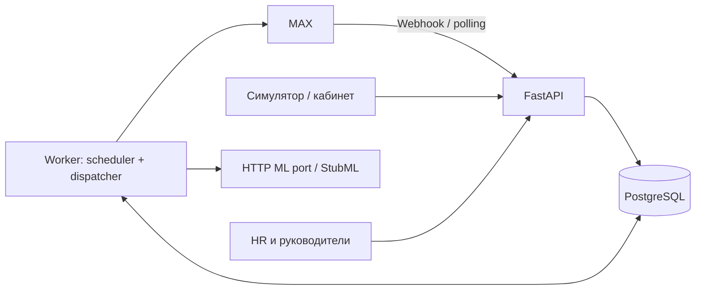
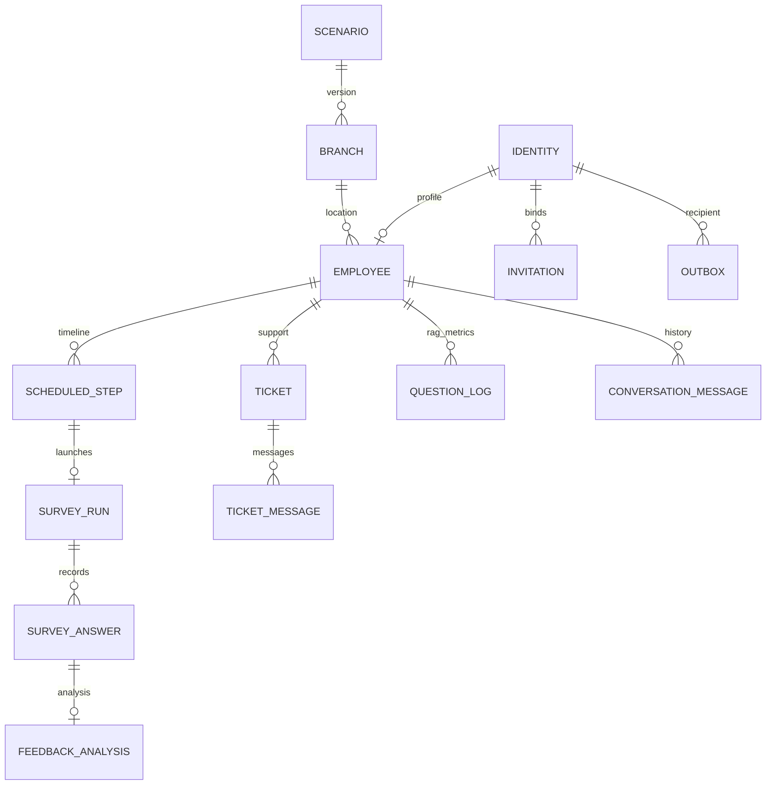

# Архитектура

Модульный монолит с отдельными процессами API, worker и необязательного MAX poller. Хранилище — PostgreSQL; для разработки совместимый SQLite. Один worker — осознанное ограничение первой версии, прежде всего из-за порядка диалогов и лимитов отправки MAX.

## Модули

- `api.py`: HTTP, сериализация, аутентификация и проверка прав на границе.
- `access.py`: рабочие роли, отдельное право управления доступом, проверка области и конкретного сотрудника.
- `employees.py`: анкета сотрудника, одноразовые приглашения, привязка MAX.
- `scenarios.py`, `calendar.py`: снимки версий, планирование, ревизии и очередь диалога.
- `surveys.py`: автомат состояний опроса и условные комментарии.
- `bot.py`: маршрутизация диалога и сохранение точки возврата.
- `ml.py`: ML port, HTTP adapter, верифицируемая заглушка.
- `documents.py`: оригиналы, метаданные, доступ и индексация.
- `tickets.py`: HR inbox, сообщения человека и возврат к опросу.
- `analytics.py`: числовые показатели, выборки, текст дайджеста на основе чисел.
- `max_client.py`: преобразование событий и реальные HTTP-запросы к MAX.
- `queue.py`, `worker.py`: durable jobs, transactional outbox, lease и повторы.
- `models.py`, `db.py`, `migrations/`: данные и миграции.
- `runtime.py`: сборка зависимостей. Fake ML/MAX можно подставить без изменения бизнес-модулей.

Модули получают явную SQLAlchemy Session в рамках unit of work. Изменение доменных данных и запись outbox атомарны. Вызовы внешнего API вынесены в адаптеры. Асинхронная обработка достигается очередью и отдельным worker; HTTP-обработчик Webhook не выполняет ML-запросы.

## Данные

`Document` хранит версию, область, checksum, путь оригинала и статус внешней индексации. `Job` хранит тип, dedupe key, дату, lease, число попыток и статус. `State` содержит тестовые часы, marker polling, правила эскалации, настройки дайджеста, кеш вложений MAX и heartbeat. `AuditEvent` хранит кто/что/какой объект без исходных текстов.

## Состояния

- Сотрудник: `invited → active → stopped`. Блокировка — `Identity.active=false`, увольнение/выключение — также `Employee.active=false`.
- Шаг: `pending/manual → enqueued → queued/dispatched → completed` либо `cancelled`. `dispatched` означает постановку в исходящую очередь, а не подтверждение чтения в MAX.
- Опрос: `active → completed`; отдельно position, awaiting_comment, selection. Активный опрос содержит снимок вопросов, чтобы публикация новой версии не меняла уже заданный вопрос.
- Обращение: `open → in_progress → closed`; флаг human_mode. Сигнал анализа не блокирует общение автоматически, ручной `/hr` и ответ HR включают человеческий режим.
- Job: `pending → running → done` или `retry/failed`. Lease измеряется реальным временем, due_at — предметным временем.
- Outbox: `pending → sending → sent` или `retry/failed/uncertain/cancelled`.

## Устойчивость

Ключ входящего сообщения — MAX message ID, callback — callback ID, start/stop — хеш события. Уникальные ограничения предотвращают повторную бизнес-обработку. Polling marker обновляется одной транзакцией с сохранением всех событий пачки.

Просроченное running-задание можно перехватить. Изменения незавершённого обработчика откатываются транзакцией. Индексация и анализ используют Idempotency-Key; ML должен поддержать этот контракт. Для MAX сообщения без подтверждённого результата требуют решения оператора. Текущий прототип не объявляет недостижимую гарантию exactly-once для внешней доставки.

MAX и ML — синхронные HTTP-клиенты с тайм-аутами внутри worker. Это упрощает восстановление транзакций. Следующий шаг при росте нагрузки: разнести ML и delivery в отдельные очереди/пулы, сериализовать задачи по employee_id, добавить распределённый rate limiter, сохранить outbox и бизнес-контракты. Простое увеличение числа worker сейчас не рекомендуется.

API и фоновый worker не должны работать с одной SQLite-базой в OneDrive во время активной синхронизации нескольких компьютеров. Для совместной разработки использовать PostgreSQL в Docker и общую запущенную копию backend. Сам исходный код может оставаться в указанной папке.

## Доступ к данным

Доступ определяется ролью, площадкой и назначением. HR — закреплённый recruiter_id. Руководитель — manager_id и область. Руководитель HR получает агрегаты, а не необработанные комментарии. Управление доступом не даёт рабочие полномочия.

ML получает список конкретных разрешённых ID/версий документов. После ответа backend проверяет каждую ссылку. Деактивированный документ не выдаётся пользователю. Ограниченный список истории относится только к текущему сотруднику. Персональные ответы не попадают в технические логи или недельный дайджест.

API-ключи для прототипа можно заменить SSO, не меняя domain services: адаптер должен вернуть активный Identity с подтверждёнными ролями и областью. Нужны отдельное согласование хранения персональных ответов, аудит реальных требований компании и нагрузочная проверка на целевом стенде.
